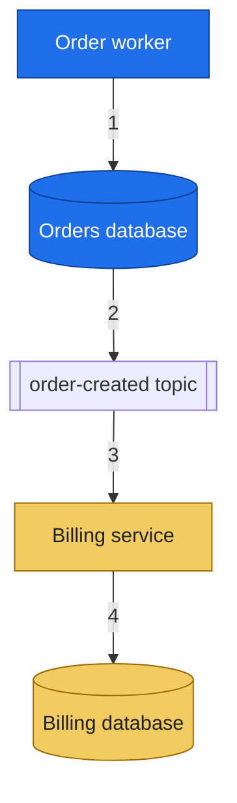

# Diagrams

Owns when a picture earns its place and how to draw it. Rendering it in a medium (a Confluence macro, an
artifact's SVG) belongs to that medium's skill.

## Draw the mechanism, never a diagram for its own sake

Draw only what prose or a table cannot show: which systems take part, where data lives and what moves
between them, numbered in order. A linear sequence of steps, stages or environments is a table; boxes in a
chain add nothing.

## Pick the kind by the idea

| Idea | Kind |
| --- | --- |
| Messages between parts over time | `sequenceDiagram` |
| Systems, stores and what flows between them | `flowchart` with numbered edges |
| States and their transitions | `stateDiagram-v2` |

One idea per diagram: today and after are two diagrams.

## Readable at page width

A wide diagram is shrunk to fit and long labels are truncated. Use `flowchart TB` beyond about four nodes,
keep labels to a few of the reader's words, and put the detail in a table under it keyed to the edge numbers.

## Colour only for meaning, through `classDef`

Colour carries one distinction, such as owner, state or before versus after. Set `fill`, `stroke` and
`color` together and pair a bold fill with white text or a bright fill with dark text, so it reads in light
and dark themes. Name classes so they cannot clash with node ids. Never `style X fill:` on its own; leave
unstyled nodes to the theme.

## Never ASCII art

Text boxes and arrows break when wrapped, ignore the theme and cannot be edited as a diagram.

## Keep the source beside the page

Keep each diagram as `diagrams/NAME.mmd` beside its page, so a change edits and re-renders the source.

| # | What moves |
| --- | --- |
| 1 | The worker writes the order and its outbox row in one transaction |
| 2 | The relay publishes the outbox row as an event |
| 3 | The topic delivers the event to billing |
| 4 | Billing stores the invoice |
