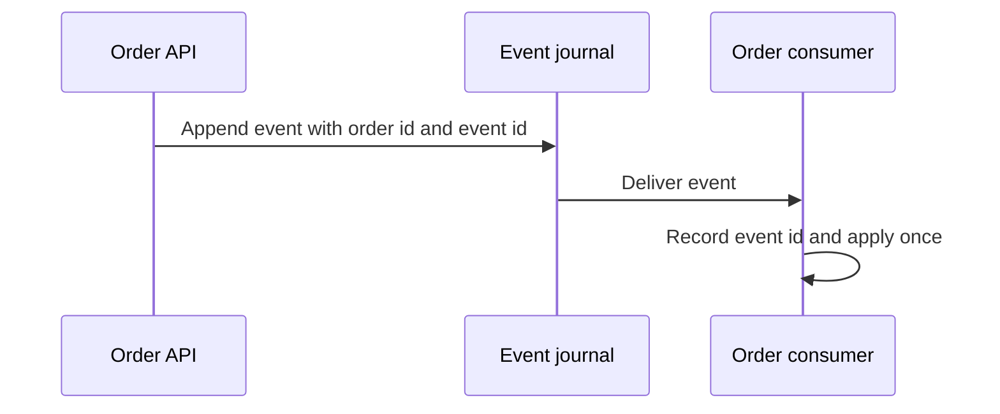

# Page layout

Owns the structure of a human-facing page so a reader can scan it, stop with the main point, and revisit detail.
Medium-specific mechanics (Confluence panels and macros, artifact styling) belong to that medium's
skill, which applies this layout with its native pieces.

## Lead with what a reader can stop at

Open with a header table of the facts a reader checks first (status, owner or role, scope, date), then
an "In 30 seconds" list of three to five bullets. A reader who stops there has the point.

## Number the sections and separate them

One subject per numbered `##` section, a `---` rule between sections, and `### 2.1`-style subsections.
Numbers let a reader say "see 4.2" and let an index link to stable anchors.

## Put parallel items in a table

Items with the same shape (options, problems, decisions, risks, steps, owners) go in a table whose
headers name the comparison, such as `Problem | Effect | Fixed by` or `Choice | Chosen | Rejected because`.
Use bullets for short independent points. Break any paragraph longer than three lines.

## Hide what most readers skip

Put option detail, change logs and question-and-answer pairs in `<details>` blocks with the question or
topic as the summary. Keep the glossary as the last section.

## Draw flows

Draw any flow across three or more parts as a Mermaid diagram: `sequenceDiagram` for order over time,
`flowchart` for structure. One idea per diagram. Colour only through `classDef` with `fill`, `stroke`
and `color` set together so it reads in light and dark themes. Never draw ASCII art.

## Keep state distinct

Say whether each thing is proposed, agreed or shipped, with a date. Open questions are a task list with
an owner each. End with the sources and the date they were read.

````markdown
# Order service redesign

| Fact | Value |
| --- | --- |
| Status | Agreed 21 Oct 2026; implementation proposed 22 Oct 2026 |
| Owner | Payments team |
| Scope | Order identifiers and event delivery |
| Date | 23 Oct 2026 |

### In 30 seconds

- Orders are keyed by one id across services.
- Consumers record event ids to handle repeated delivery safely.
- Journal retention remains an open decision owned by Ana.

---

## 1. Why it changed

| Problem | Effect | Fixed by |
| --- | --- | --- |
| Two id maps | Duplicate orders | One order id across services |
| Repeated delivery | Repeated processing | Consumer records processed event ids |

---

## 2. Event delivery

### 2.1 Agreed flow — 21 Oct 2026



---

## 3. Options

<details>
<summary>Why retain an event journal?</summary>

| Option | Recovery | Decision |
| --- | --- | --- |
| Durable journal | Replay missed events | Agreed 21 Oct 2026 |
| Direct delivery | Caller retries each failure | Rejected 21 Oct 2026 |

</details>

---

## 4. Delivery state

| Change | State | Date |
| --- | --- | --- |
| Shared order id | Agreed | 21 Oct 2026 |
| Event journal | Proposed | 22 Oct 2026 |
| Consumer event-id recording | Shipped | 23 Oct 2026 |

---

## 5. Open questions

- [ ] Retention period for the event journal (owner: Ana)

---

## 6. Glossary

| Term | Meaning |
| --- | --- |
| Event journal | Durable sequence of events available for replay |

Sources: [Order event contract](order-event-contract.md), read 23 Oct 2026.
````
